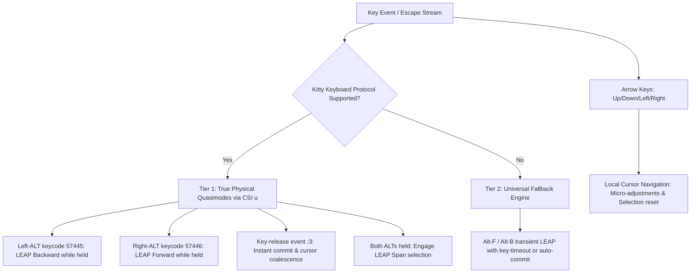
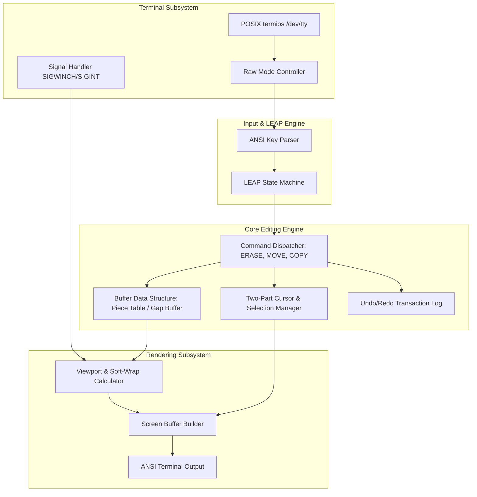
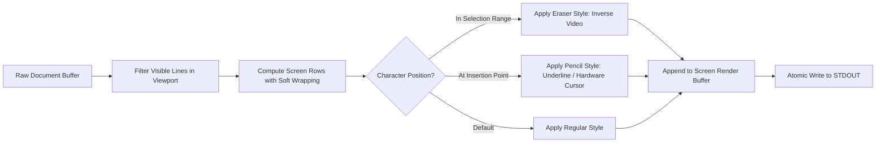
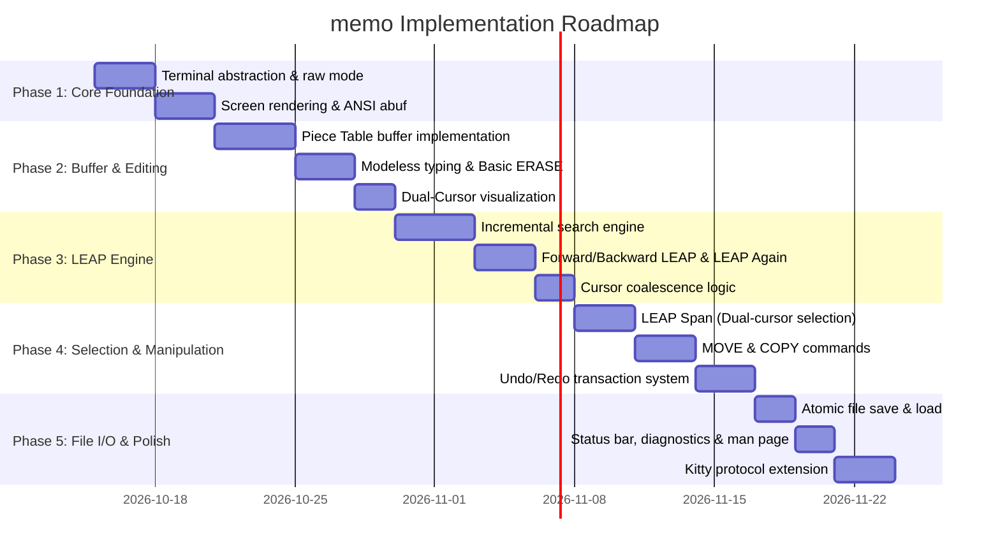

# `memo` Specification (SPEC.md)

## 1. Executive Summary & Vision

`memo` is a lightweight, zero-dependency, POSIX-compliant full-screen text editor written in C. It reimagines modern terminal text editing through the interface philosophy of Jef Raskin's **Canon Cat** (1987) and *The Humane Interface* (2000).

Unlike traditional modal editors (`vi`/`vim`) or control-heavy editors (`emacs`, `nano`), `memo` operates on two core pillars:
1. **Modeless Text Flow with a Two-Part Cursor**: At all times, typing inserts text. The interface explicitly separates the insertion point (**The Pencil**) from the deletion/target point (**The Eraser**), eliminating ambiguity around what character or range an action affects.
2. **True LEAP Quasimodes with Dedicated Keys**: Navigation is centered on physical LEAP keys flanking the spacebar—**Right-ALT** for LEAP Forward and **Left-ALT** for LEAP Backward. Holding the key down while typing engages an incremental search quasimode; releasing the key commits the destination. Pressing both Left-ALT and Right-ALT engages span selection.
3. **Local Arrow Key Navigation**: Standard cursor movement keys (`Up`, `Down`, `Left`, `Right`) are fully supported for intuitive small, fine-grained local adjustments without requiring a search leap.

```
       +-------------------------------------------------------+
       | memo v0.1 - [notes.txt]                     12:00:00  |
       +-------------------------------------------------------+
       | The quick brown fox [jumps] over the lazy dog.        |
       |                      ^---^                            |
       |                      Solid Eraser Highlight           |
       |                           ^                           |
       |                           Blinking Pencil Insertion   |
       |                                                       |
       | Modeless typing inserts directly at the pencil.       |
       | Pressing ERASE removes the highlighted eraser target. |
       | Standard arrow keys move cursor locally.              |
       +-------------------------------------------------------+
       | LEAP FWD [Hold Right-Alt]: "ju" [Match 1 of 3]        |
       +-------------------------------------------------------+
```

---

## 2. Terminal Input & Quasimode Architecture

`memo` is built on direct POSIX terminal programming (`<termios.h>`) and ANSI/VT100 escape codes, with zero external dependencies.

### 2.1 Direct POSIX Terminal Control

Direct terminal manipulation provides complete control over the event loop, input parsing, non-blocking I/O, and 2D full-screen rendering:
* **Raw Mode Setup**: Configures terminal attributes via `tcgetattr()` and `tcsetattr()` (`c_lflag &= ~(ECHO | ICANON | IEXTEN | ISIG); c_iflag &= ~(BRKINT | ICRNL | INPCK | ISTRIP | IXON); c_oflag &= ~(OPOST); c_cflag |= (CS8);`).
* **Non-Blocking / Responsive I/O**: Configures low-latency input using `VMIN = 0`, `VTIME = 1` and `poll()` on `STDIN_FILENO` for instant responsiveness during incremental LEAP operations.
* **Dual-Cursor Rendering**: Full programmatic control over terminal SGR styling:
  * **Insertion Cursor (The Pencil)**: Hardware cursor placement (`\x1b[<row>;<col>H`) or high-contrast styling.
  * **Eraser Highlight**: Solid inverse video (`\x1b[7m`) or distinct background styling (`\x1b[48;5;...m`).
* **Screen Management**: Alternate screen buffer switching (`\x1b[?1049h` / `\x1b[?1049l`), window resize handling (`SIGWINCH` and `TIOCGWINSZ`), and clean teardown.

### 2.2 Terminal Quasimodes & Dedicated LEAP Keys

On the original Canon Cat, LEAP was operated as a physical **quasimode** via two dedicated keys positioned directly under the spacebar. On modern ANSI/PC keyboards, the spacebar is naturally flanked by **Left-ALT** and **Right-ALT**—making them the ideal physical equivalents for LEAP Backward and LEAP Forward.

```
       +-------------------------------------------------------------+
       |   [Left-ALT]   |         [SPACEBAR]         |  [Right-ALT]  |
       |  (LEAP BACK)   |                            |  (LEAP FWD)   |
       +-------------------------------------------------------------+
```

#### Protocol & Input Architecture

Standard POSIX terminals communicate via byte streams on key-press/repeat and do not emit key-release events by default. To achieve true physical hold-to-LEAP quasimodes, `memo` implements a two-tier input strategy:



1. **Tier 1: True Physical Quasimodes (Kitty Keyboard Protocol / CSI u)**
   * During initialization, `memo` queries terminal capabilities (`\x1b[?u`) and requests progressive keyboard enhancement flags `1 | 2 | 8` (disambiguate codes + event types + report all keys).
   * **Left-ALT (`keycode 57445`)**: Holding down Left-ALT activates **LEAP Backward**. Printable keys typed while held form the incremental backward search term.
   * **Right-ALT (`keycode 57446`)**: Holding down Right-ALT activates **LEAP Forward**. Printable keys typed while held form the incremental forward search term.
   * **Key-Release (`event type :3`)**: When the user releases the ALT key, `memo` instantly commits the cursor at the current match and coalesces the pencil and eraser.
   * **LEAP-LEAP (Both ALTs)**: Holding both Left-ALT and Right-ALT simultaneously engages the selection span between the leap origin and current destination.
   * Supported out of the box in modern terminals including Ghostty, Kitty, WezTerm, Foot, iTerm2, and Neovim terminal.

2. **Tier 2: Universal POSIX Fallback (Legacy Terminals)**
   * In legacy terminals or basic SSH sessions without CSI u support, Left and Right ALT transmit standard ESC (`\x1b`) prefixes without release events.
   * `memo` falls back to a transient LEAP state triggered by `Alt-F` / `Alt-B` (or `Ctrl-F` / `Ctrl-R`), where typed characters incrementally jump and any non-search key (or Enter/Esc) commits the destination.

### 2.3 Local Cursor Navigation (Arrow Keys)

While LEAP replaces arrow keys for macro document navigation, `memo` provides full, first-class support for standard arrow keys (`Up`, `Down`, `Left`, `Right`) for fine-grained local editing:
* ANSI escape codes (`\x1b[A`, `\x1b[B`, `\x1b[C`, `\x1b[D`) are processed directly in the main event loop.
* Moving an arrow key collapses any active multi-character selection and moves the Pencil (insertion point) to the adjacent character or line.
* The Eraser highlight moves in tandem, adhering to the Fundamental Cursor Rule.

---

## 3. Canon Cat Behavioral Specification

### 3.1 The Two-Part Cursor: Pencil & Eraser

Standard editors use a single point (vertical bar or block) which creates ambiguity during deletion: does backspace delete the character to the left, the character under the cursor, or a hidden selection?

`memo` eliminates this ambiguity using the Canon Cat's two-part cursor:

#### 1. The Insertion Point ("The Pencil")
* **Appearance**: Hardware blinking bar/underline or blinking reverse block.
* **Role**: Defines where characters will be inserted if the user types.
* **Behavior**: Always positioned immediately adjacent to the insertion location.

#### 2. The Target Highlight ("The Eraser")
* **Appearance**: Inverse video (`\x1b[7m`) or distinct background color covering one or more characters.
* **Role**: Defines the exact character(s) that will be removed if the user presses `ERASE` (Backspace/Delete).

#### The Fundamental Cursor Rule
> **"You can either type at the pencil or erase at the eraser."**

* **After regular typing**: The pencil sits immediately after the newly typed character; the eraser highlights the character just typed. Pressing `ERASE` removes that character.
* **After LEAP navigation**: The two cursors **coalesce** onto the found match. The target word is highlighted by the eraser, and the pencil sits at its boundary.
  * Typing immediately inserts text at the pencil.
  * Pressing `ERASE` deletes the highlighted target.
* **Span Selection (Dual Boundaries)**: When a range is selected (e.g. via LEAP-LEAP), the eraser expands to cover the entire selected span. Pressing `ERASE` deletes the entire span.

```
State A: Regular Typing (Pencil after 't', Eraser on 't')
    c a [t]|
        ^^^
         |-- Eraser highlight (Backspace will delete 't')
           |-- Pencil insertion point (typing 's' gives "cats")

State B: Coalesced After LEAP to "world"
    h e l l o   [w o r l d]|
                ^^^^^^^^^^^
                     |-- Eraser highlight (ERASE will delete "world")
                           |-- Pencil insertion point
```

---

### 3.2 LEAP Navigation Mechanics

LEAP is the primary vehicle for navigation, designed as a reflexive, modeless quasimode operated by the physical ALT keys.

#### 1. Directional LEAP Keys
* **LEAP Forward (Right-ALT held)**: Searches forward from the current cursor position toward the end of the document.
* **LEAP Backward (Left-ALT held)**: Searches backward from the current cursor position toward the beginning of the document.

#### 2. Incremental Search while Held
* The user presses and holds **Right-ALT** (for forward) or **Left-ALT** (for backward).
* As search characters are typed, the cursor jumps incrementally to the first matching string in that direction.
* The search pattern narrows with each additional character typed.
* Search is **case-insensitive** if only lowercase characters are typed, and becomes **case-preserving/exact** if uppercase characters are entered.
* **Releasing the ALT key** immediately commits the cursor at the target and returns to standard typing.

#### 3. LEAP Again (Cycle Matches)
* While holding the LEAP key (or immediately after reaching a match), re-pressing the LEAP key (or tapping it) advances to the *next* occurrence of the active search string in that direction.
* Wrapping: Reaching the buffer boundary wraps smoothly to the opposite end with a status line indication.

#### 4. Creep Navigation
* In the Canon Cat, fine-grained single-character nudging was done via "creeping": holding a LEAP key and tapping Space moved the cursor forward or backward character by character.
* In `memo`, tapping Space while holding a LEAP key without typing a pattern creeps forward (Right-ALT) or backward (Left-ALT) by one character.

---

### 3.3 Local Navigation via Cursor Keys (Arrow Keys)

While LEAP provides rapid macro navigation across lines and pages, standard cursor keys are supported for local micro-navigation:
* **`Left Arrow` / `Right Arrow`**: Moves the Pencil insertion point left or right by one character.
* **`Up Arrow` / `Down Arrow`**: Moves the Pencil insertion point up or down by one screen line, attempting to preserve the visual column.
* **Cursor Interaction**: Moving with arrow keys immediately collapses any active multi-character selection span and coalesces the Pencil and Eraser to the new character position.

---

### 3.4 Text Selection: LEAP-LEAP / Dual-Cursor Span

In mouse-driven systems, selection requires click-and-drag. In `memo`, selection is keyboard-driven via LEAP endpoints:

1. **Setting the Span Origin**: The user leaps to the beginning of the desired block using Left-ALT or Right-ALT. The cursor is placed at point $A$.
2. **Leaping to the Destination**: The user leaps to the end of the desired block. The cursor moves to point $B$.
3. **Engaging the Span (LEAP Both / LEAP-LEAP)**:
   * Pressing or holding **both Left-ALT and Right-ALT** simultaneously highlights all text between point $A$ and point $B$.
   * The Eraser expands to encompass the entire region $[A, B]$.
   * The Pencil rests at point $B$.

---

### 3.5 Modeless Editing Operations: ERASE, MOVE, and COPY

Traditional editors require separate Cut, Copy, and Paste commands involving an invisible clipboard buffer. The Canon Cat and `memo` replace this with immediate, direct manipulation:

```mermaid
sequenceDiagram
    autonumber
    actor User
    participant Editor as memo Buffer
    
    Note over User,Editor: Text Relocation (MOVE) Workflow
    User->>Editor: LEAP to block start & end + LEAP-LEAP (Select block)
    Note over Editor: Range [A, B] highlighted by Eraser
    User->>Editor: LEAP to destination C
    Note over Editor: Pencil is now at C; Selection remains at [A, B]
    User->>Editor: Press MOVE
    Editor->>Editor: Text [A, B] is extracted and inserted at C
    Note over Editor: Target text relocated; Cursors coalesce at C
```

#### 1. ERASE
* If a single character is highlighted by the eraser, `ERASE` deletes that character.
* If a multi-character span is highlighted by the eraser, `ERASE` deletes the entire span.
* Modeless: No need to toggle "delete mode" or switch to a normal mode.

#### 2. MOVE (Relocate without Clipboard)
1. Select the text block (Eraser covers the range).
2. LEAP to the destination where the text should go (Pencil moves to target destination; eraser selection remains visually distinct).
3. Press `MOVE`.
4. The selected text is atomically extracted from its origin and inserted at the destination.

#### 3. COPY (Duplicate without Clipboard)
1. Select the text block.
2. LEAP to the destination.
3. Press `COPY`.
4. The selected text is duplicated at the destination while leaving the original untouched.

#### 4. Universal UNDO
* Coalesced undo stack: Sequences of consecutive character insertions, deletions, moves, or copies are grouped into coherent undo units.
* Pressing `UNDO` reverses the last operation and restores the previous cursor and selection state.

---

## 4. Keybinding & Terminal Input Architecture

`memo` is designed for ergonomic touch-typing on standard modern ANSI/PC keyboards, utilizing the physical Left and Right ALT keys flanking the spacebar as genuine LEAP keys, alongside standard arrow keys for local navigation.

### 4.1 Default Keyboard Layout

| Function | Primary Keybinding (Quasimode / Key) | Fallback / Secondary Keybinding | Behavior |
| :--- | :--- | :--- | :--- |
| **LEAP Forward** | **Hold `Right-ALT`** + type term | `Alt-F` + type term | Incremental forward jump while held |
| **LEAP Backward** | **Hold `Left-ALT`** + type term | `Alt-B` + type term | Incremental backward jump while held |
| **LEAP Again** | Tap `Right-ALT` / `Left-ALT` again | `Alt-F` / `Alt-B` | Jump to next occurrence of current pattern |
| **Commit LEAP** | Release `ALT` key | `Enter` / `Esc` | Commits destination and coalesces cursors |
| **LEAP Span (Select)** | **Hold `Left-ALT` + `Right-ALT`** | `Alt-S` / `Ctrl-Space` | Highlights span between origin and current destination |
| **Local Move Up** | `Up Arrow` (`\x1b[A`) | `Ctrl-P` | Move cursor up 1 line; resets selection |
| **Local Move Down** | `Down Arrow` (`\x1b[B`) | `Ctrl-N` | Move cursor down 1 line; resets selection |
| **Local Move Left** | `Left Arrow` (`\x1b[D`) | `Ctrl-B` | Move cursor left 1 char; resets selection |
| **Local Move Right** | `Right Arrow` (`\x1b[C`) | `Ctrl-F` | Move cursor right 1 char; resets selection |
| **Creep Forward** | `Space` (while holding LEAP) | `Alt-Right` | Single-character forward nudge |
| **Creep Backward** | `Backspace` (while holding LEAP) | `Alt-Left` | Single-character backward nudge |
| **ERASE** | `Backspace` (`\x7f`) | `Delete` (`\x1b[3~`) | Delete eraser target (character or selection) |
| **MOVE** | `Alt-M` | `Ctrl-X M` | Move selected span to current cursor position |
| **COPY** | `Alt-C` | `Ctrl-X C` | Copy selected span to current cursor position |
| **UNDO** | `Alt-U` | `Ctrl-Z` / `Ctrl-_` | Revert previous editing transaction |
| **Save File** | `Ctrl-S` | `Alt-W` | Save buffer to disk |
| **Quit** | `Ctrl-Q` | `Ctrl-X Ctrl-C` | Exit editor (prompts if unsaved changes exist) |

*Note: All standard printable characters (ASCII `0x20` to `0x7E` and UTF-8 multi-byte sequences) insert text directly into the buffer at all times.*

---

## 5. System Architecture & Data Structures

### 5.1 Architecture Overview



### 5.2 Buffer Representation: Piece Table vs. Gap Buffer

For a lightweight POSIX editor with Canon Cat mechanics:

| Structure | Memory Overhead | Insert/Delete Cost | Range Move/Copy Cost | Undo Integration |
| :--- | :--- | :--- | :--- | :--- |
| **Line Array** | High (per-line pointers) | Moderate | Complex across lines | Moderate |
| **Gap Buffer** | Very Low | $O(1)$ at gap, $O(N)$ shift | Requires buffer shift | Snapshot/diff needed |
| **Piece Table** | Low | $O(1)$ node insertion | $O(1)$ pointer splice | Native & instant |

#### Decision: Piece Table (or Double-Buffered Piece Chain)
* **Rationale**: Canon Cat operations frequently involve relocating entire blocks of text (`MOVE`), duplicating text (`COPY`), and modelessly searching across a continuous text stream.
* A **Piece Table** maintains:
  1. An immutable **Original Buffer** (file contents read from disk).
  2. An append-only **Add Buffer** (newly typed characters).
  3. A doubly linked list or balanced tree of **Pieces** pointing to spans in either buffer.
* **Benefits for `memo`**:
  * `MOVE` is a simple splice of piece nodes ($O(1)$).
  * `COPY` creates new pieces referencing existing buffer ranges without memory copying.
  * `UNDO` requires rolling back the piece list pointers, providing infinite, cheap undo.

---

### 5.3 Viewport & Dual-Cursor Rendering Pipeline



1. **Screen Buffer Batching**: Rendering uses an append buffer (`abuf`) that aggregates ANSI escape sequences and writes the entire frame to standard output in a single `write()` call, preventing screen tearing and flicker.
2. **Alternate Screen Buffer**: Uses ANSI `\x1b[?1049h` on startup and `\x1b[?1049l` on teardown to preserve the user's terminal history.
3. **Status Line**:
   * Top or bottom status bar displays filename, modification status, row/column, and current LEAP state.
   * During LEAP: Displays the search direction, query string, match count, and feedback.

---

## 6. Directory Structure & File Organization

The project will be organized as follows:

```
memo/
├── Makefile                # POSIX-compliant Makefile (C99/C11, -Wall -Wextra -pedantic)
├── SPEC.md                 # This specification document
├── README.md               # User guide, installation, and tutorial
├── doc/
│   └── memo.1              # POSIX man page
└── src/
    ├── main.c              # Entry point, CLI argument parsing (getopt)
    ├── terminal.h          # POSIX termios management, raw mode, ANSI helpers
    ├── terminal.c          # Terminal dimensions, signals (SIGWINCH), screen enter/exit
    ├── input.h             # Input key codes, escape sequence parsing
    ├── input.c             # Non-blocking key reader, Kitty protocol detection
    ├── buffer.h            # Piece table data structure & buffer interface
    ├── buffer.c            # Buffer insertion, deletion, splice (MOVE/COPY), file I/O
    ├── leap.h              # LEAP engine: forward/backward search, incremental matching
    ├── leap.c              # Search algorithms, pattern matching, match cycle
    ├── cursor.h            # Dual-cursor state: Pencil, Eraser, Span selection
    ├── cursor.c            # Coalescence logic, selection expansion, cursor motion
    ├── render.h            # Viewport calculation, screen layout, soft wrapping
    ├── render.c            # ANSI render buffer builder, dual cursor styling
    └── editor.h            # Central editor state container, command dispatcher
```

---

## 7. POSIX Compliance & Portability Standards

`memo` will strictly adhere to the following POSIX standards:

1. **Standard Headers**:
   * Uses only POSIX-standard headers: `<termios.h>`, `<unistd.h>`, `<sys/ioctl.h>`, `<sys/types.h>`, `<sys/stat.h>`, `<fcntl.h>`, `<signal.h>`, `<errno.h>`, `<stdlib.h>`, `<string.h>`, `<stdio.h>`.
2. **Signal Handling**:
   * `SIGWINCH`: Updates terminal rows/columns via `TIOCGWINSZ` and triggers immediate redraw.
   * `SIGTERM` / `SIGHUP`: Safely saves emergency backup buffer (`.memo.bak`) and restores terminal mode.
   * `SIGCONT`: Restores raw terminal state and redraws screen when suspended and resumed via job control (`Ctrl-Z`).
3. **Atomic File I/O**:
   * File writes are performed atomically: writing to a temporary file (`.memo_tmp.XXXXXX`) in the same directory, followed by `fsync()` and `rename()`, preserving original file permissions and preventing data loss on crash or power failure.
4. **Toolchain Compatibility**:
   * Compiles cleanly under `gcc`, `clang`, and `musl-gcc` with `-std=c99` (or `-std=c11`), `-Wall`, `-Wextra`, and `-pedantic`.
   * Zero third-party library dependencies.

---

## 8. Implementation Roadmap



### Milestone Checklist
- [ ] **Milestone 1**: Terminal enters raw mode, renders text buffer, and cleanly exits on `Ctrl-Q`.
- [ ] **Milestone 2**: Modeless text insertion works; pencil and eraser are rendered distinctly.
- [ ] **Milestone 3**: Right-ALT (forward) and Left-ALT (backward) held keys perform instantaneous incremental LEAP searches; arrow keys provide local navigation.
- [ ] **Milestone 4**: Range selection works via LEAP-LEAP (both ALTs held); `ERASE` deletes highlighted range; `MOVE` and `COPY` relocate text.
- [ ] **Milestone 5**: Full POSIX atomic file persistence, undo/redo, and man page documentation complete.
